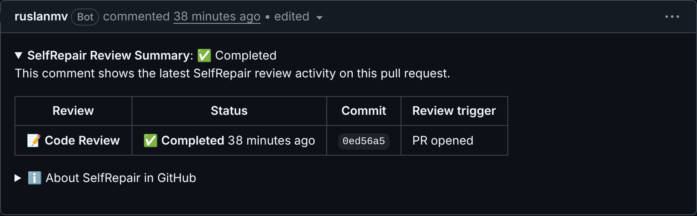

# Codex-style pull-request review

SelfRepair reviews pull requests the way developers know from hosted AI
reviewers. SelfRepair owns the GitHub App, triggers, policy and publication.
The model review runs through any OpenAI-compatible endpoint (OllaBridge Cloud
by default). GitPilot writes fixes, and only when a maintainer asks.

## What appears on a pull request

| When | What |
| --- | --- |
| Review starts | 👀 on the pull request (or on the `@selfrepair review` comment). The status comment gets a `🔄 Running` row. The `SelfRepair / Review` check is `in_progress`. |
| Review ends | The status comment row becomes `✅ Completed` / `⚠️ Incomplete` / `❌ Failed`. The check completes. A **💡 SelfRepair Review** names the reviewed commit and carries inline suggestions. |
| Clean commit | "Didn't find any major issues. 🚀" and 👍 on the pull request. |
| Review could not finish (model unavailable, diff unreadable, parts unreviewed) | "⚠️ Couldn't finish reviewing this commit" with the reason. Never the clean-commit message, never 👍, and the check is not a pass. |
| Re-review, nothing new | Only the check and status comment change; suggestions already posted are not repeated. |



Status comment (one per pull request, edited in place, last five rows, collapsed;
`<relative-time>` renders as "2 minutes ago" on GitHub):

```
<details>
<summary><strong>SelfRepair Review Summary</strong>: ✅ Completed</summary>

| Review | Status | Commit | Review trigger |
| 📝 **Code Review** | ✅ **Completed** <relative-time datetime="2026-11-13T10:02:00Z">…</relative-time> | `af3a4d7` | PR opened |
</details>
```

Inline suggestion:

```
**<sub><sub></sub></sub>  Allow the configuration form to shrink and scroll**

On short viewports … Make the form a shrinkable flex column …

Useful? React with 👍 / 👎.
```

Priorities map from severity: critical → P0, high → P1, medium → P2,
low/info → P3. `reviewer.review.min_inline_priority` (default `P2`) sets the
lowest priority posted inline; lower ones are listed in the review body and
always reach the check.

## Commands

| Comment on a pull request | Effect |
| --- | --- |
| `@selfrepair review` | Review the latest head again (drafts included). |
| `@selfrepair fix` / `@selfrepair address …` | Send the open suggestions of the latest review to GitPilot `POST /repair` in `draft_pr` mode, approved by the commenter. Requires `reviewer.remediation.enabled`. Forks are refused. |

Handles: `reviewer.mentions.handles` (default `selfrepair`, `gitpilot`).
Only `reviewer.mentions.allowed_associations` (default OWNER, MEMBER,
COLLABORATOR) are obeyed. Bot comments, quoted lines and code blocks are ignored.
Each command runs once per comment: a redelivered webhook does not start a
second review or a second GitPilot task.

## Engine `llm`

`reviewer.engine: llm` with `SELFREPAIR_REVIEW_LLM_URL`,
`SELFREPAIR_REVIEW_MODEL` and `SELFREPAIR_REVIEW_LLM_KEY`.

- The diff is redacted (`selfrepair.ci.redaction`) and rendered with new-file
  line numbers, so citations are exact.
- The prompt asks only for discrete, actionable bugs introduced by the diff,
  P0–P3, JSON only; repository text is declared untrusted.
- Findings below 0.55 confidence, on files outside the diff, or on lines the
  diff does not contain are dropped (the latter by the validator).
- Large diffs are split by file, and a file larger than one call at hunk
  boundaries (60k characters per call, at most 6 calls, within
  `execution.max_runtime_seconds`). Parts that are not sent, or lines too long
  to send, make the run incomplete rather than passing.
- A reply without a `findings` array (`{}`, an error object) is not a review:
  the engine raises `EngineUnavailable`.
- No key, a refused key, or a bad reply raises `EngineUnavailable`: the
  deterministic findings are kept and the check is not a pass.

## Large pull requests

A review must cover the whole change or say clearly what it did not cover.
Reviewing [ruslanmv/SelfRepair#14](https://github.com/ruslanmv/SelfRepair/pull/14)
(67 files, 3.4 million characters of diff) shaped these rules:

| Step | What happens | Why |
| --- | --- | --- |
| 1. Skip generated files | Lockfiles, `dist/`, `node_modules/`, `*.min.js`, source maps and hashed bundler output (`assets/index-Dx2aEjyp.js`) are left out and listed in the check summary. | In #14 they were 3 of the 3.4 million characters and pushed 55 real files out of the budget. |
| 2. Order by risk | Security-sensitive code first (auth, secrets, tokens, SQL, migrations, webhooks, sandbox), then other code, CI/config, tests, docs. | If the budget runs out, what is left unread is the least risky. |
| 3. Split into parts | About 24k characters per model call. A file larger than that is split at hunk boundaries, never cut. A single line over the limit is shortened and marks the review incomplete. | Free routers keep a prompt this size on fast providers. Larger prompts fell back to a model whose hidden reasoning used up the output budget and cut the JSON off. |
| 4. Review in parallel | Three parts at a time, at most 32 parts, inside `execution.max_runtime_seconds`. | #14 (26 parts) finishes in about six minutes. |
| 5. Recover per part | A part whose reply is cut off or not JSON is asked again once ("compact JSON, at most 5 findings"); complete findings are salvaged from a cut-off reply; other parts are kept. Only a refused key stops the whole review. | One bad answer no longer throws away the rest. |
| 6. Merge and rank | Duplicate findings on one line are merged (most severe wins). The 10 most important go inline (`review.max_inline_comments`); the rest are listed in the review. | Fewer, better comments get read. |

Anything not reviewed is named: "2 of 26 parts could not be fully reviewed (…)",
"diff too large", "lines too long to review in …". Such a review is never a pass.

### Secrets and redaction

The diff is redacted before it leaves SelfRepair with `redact_code`, a
code-aware variant of the CI-log redactor. It hides known token formats
(GitHub, GitLab, Hugging Face, OpenAI/Anthropic, AWS, npm, PyPI, private
keys, credentials in URLs), quoted values assigned to secret-like names, and
high-entropy string literals. It leaves code such as
`secret = os.environ.get("KEY")` readable: the log redactor hid such lines and
the model then reported the markers as syntax errors. The model is told that
`<<REDACTED:…>>` is not code.

## Same as Codex, and what SelfRepair adds

Matches the behaviour visible in Codex's comments on this repository:
status comment edited in place, 👀 while reviewing and 👍 on a clean result,
"💡 … Review" with the reviewed commit, P0–P3 badged inline suggestions,
"Useful? React with 👍 / 👎.", re-review on request, and a fix request
answered with a new pull request.

On top of that, SelfRepair:

- sets a merge-gating check run (`SelfRepair / Review`) with annotations, and
  lets each repository choose which severities block (`review.block_on`);
- uses any OpenAI-compatible model, by default OllaBridge's free-first router,
  so reviews cost nothing unless you pick a paid model;
- handles very large pull requests explicitly (see above) and never reports a
  partial review as a pass;
- redacts secrets from the diff before it reaches the model;
- obeys `@selfrepair` only from owners, members and collaborators, once per
  comment;
- sends fixes to GitPilot as a human-approved draft pull request that is never
  merged automatically;
- reviews GitLab merge requests (commit status and note) as well;
- runs on your own infrastructure: the Hugging Face Space edition or the full
  server.

## Hugging Face development edition

`selfrepair.reviewer.space_app` runs the reviewer in one process with an
in-memory store. See `deploy/huggingface-review/README.md` for the Space and the
token-protected GitHub App manifest setup.
